# DeepAgent Inbox Monitor

`inbox-da` is a financial inbox monitor for Oracle-backed email sources. It
copies email rows and optional attachment BLOBs from Oracle into a local SQLite
audit store, parses attachments, runs LangChain DeepAgents extraction and
verification passes, and writes auditable structured records.

The required model default is `gemini-3-flash-preview` for extraction,
verification, image parsing, and scanned or low-text PDF parsing.

## Quick Start

```bash
uv sync
cp .env.example .env
uv run inbox-da init-db
uv run inbox-da sync-oracle --limit 50
uv run inbox-da process --email-id 1 --offline-demo
uv run inbox-da inspect --email-id 1
```

Set `GOOGLE_API_KEY` in your shell or `.env` before running live Gemini agent
commands. Set Oracle credentials in environment variables or `configs/default.yaml`
before running `sync-oracle`; the default password source is
`ORACLE_DB_PASSWORD`.

## Command Map

```bash
uv run inbox-da init-db
uv run inbox-da agent-info
uv run inbox-da sync-oracle --limit 50
uv run inbox-da ingest-one
uv run inbox-da process --email-id 1
uv run inbox-da process --email-id 1 --offline-demo
uv run inbox-da watch --interval 5
uv run inbox-da watch --once --offline-demo
uv run inbox-da inspect --email-id 1
uv run inbox-da trace --email-id 1
uv run inbox-da export-trace --email-id 1 --output data/email_1_trace.csv
uv run inbox-da cost-report
uv run inbox-da cost-report --format csv --output data/cost_report.csv
uv run inbox-da export --format csv
uv run inbox-da web --host 127.0.0.1 --port 8000
```

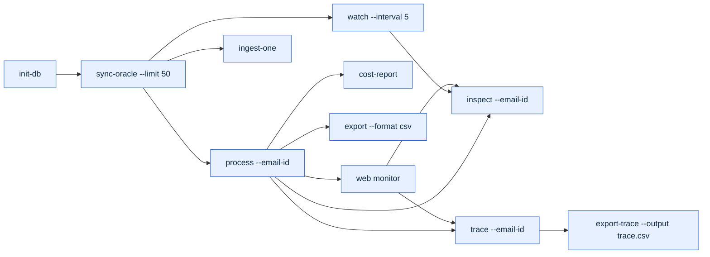

The CLI uses Rich panels, spinners, progress indicators, and tables so long
agent runs show visible progress through config loading, database access,
attachment parsing, extractor pass A, extractor pass B, verification, writes,
cost estimation, and final status. Each event is also persisted as an
email-level extraction trace.

## Repository Map

```mermaid
flowchart TB
    repo["inbox-da"] --> pyproject["pyproject.toml<br/>uv package metadata, deps, ruff, pytest"]
    repo --> config["configs/default.yaml<br/>model, Oracle source, paths, watch interval, costs, agent runtime"]
    repo --> env[".env.example<br/>GOOGLE_API_KEY template"]
    repo --> src["src/inbox_da"]
    repo --> tests["tests"]
    repo --> skills["skills/project"]
    repo --> memory["memories/AGENTS.md"]
    repo --> data["data<br/>runtime SQLite, exports, attachments"]
    repo --> docs["README.md and AGENTS.md"]

    src --> cli["cli.py<br/>Typer and Rich commands"]
    src --> agent["agent.py<br/>process_email workflow"]
    src --> attachments["attachments.py<br/>TXT, CSV, XLSX, PDF, image parsing"]
    src --> db["db.py<br/>typed SQLite repository functions"]
    src --> schema["schema.sql<br/>database DDL"]
    src --> models["models.py<br/>Pydantic output contracts"]
    src --> provider["model_provider.py<br/>Gemini and DeepAgents factory"]
    src --> oracle["oracle_inbox.py<br/>read-only Oracle sync adapter"]
    src --> costing["costing.py<br/>token usage and cost estimates"]
    src --> logging["logging_utils.py<br/>Rich terminal output"]
    src --> cfg["config.py<br/>YAML and .env settings"]
    src --> webapp["web.py<br/>FastAPI monitoring console"]
    src --> templates["templates/*.html<br/>Jinja2 pages"]
    src --> static["static/app.css<br/>dashboard styling"]

    skills --> skillA["attachment-analysis"]
    skills --> skillB["financial-extraction"]
    skills --> skillC["verification"]

    tests --> t1["workflow tests"]
    tests --> t2["CLI smoke tests"]
    tests --> t3["schema and attachment tests"]
    tests --> t4["config, model, logging tests"]

    classDef repo fill:#f8f9fa,stroke:#111827,stroke-width:2px
    classDef runtime fill:#eefdf3,stroke:#15803d,color:#052e16
    classDef code fill:#fff7ed,stroke:#c2410c,color:#431407
    classDef tests fill:#f5f3ff,stroke:#7c3aed,color:#2e1065
    classDef docs fill:#fefce8,stroke:#a16207,color:#422006
    class repo repo
    class data,config,env runtime
    class src,cli,agent,attachments,db,schema,models,provider,oracle,costing,logging,cfg,webapp,templates,static code
    class tests,t1,t2,t3,t4 tests
    class docs,skills,memory,skillA,skillB,skillC docs
```

## Runtime Architecture

```mermaid
flowchart TB
    user["Operator"] --> cli["Typer CLI<br/>src/inbox_da/cli.py"]
    user --> webui["FastAPI web console<br/>src/inbox_da/web.py"]
    cli --> settings["Settings<br/>config.py + configs/default.yaml + .env"]
    webui --> settings
    settings --> dbconn["SQLite connection<br/>db.connect"]
    dbconn --> schema["schema.sql<br/>init_db"]

    cli --> oracle["Oracle inbox reader<br/>oracle_inbox.sync_oracle_inbox"]
    oracle --> source["Oracle email table<br/>read-only SELECT"]
    oracle --> emails["emails table"]
    oracle --> attachmentfiles["data/attachments/<email_id>/..."]
    oracle --> attachmentsdb["attachments table"]

    cli --> workflow["process_email<br/>agent.py"]
    workflow --> attachmentparser["Attachment parser<br/>attachments.py"]
    attachmentparser --> attachmentfiles
    attachmentparser --> attachmentsdb
    attachmentparser --> vision["Gemini vision parser<br/>images and low-text PDFs"]

    workflow --> model["ChatGoogleGenerativeAI<br/>gemini-3-flash-preview"]
    workflow --> deepagents["DeepAgents extractor and verifier"]
    deepagents --> subagents["sync subagents<br/>attachment-reader, extractor, verifier, review-agent"]
    deepagents --> skills["project skills"]
    deepagents --> memory["project memory"]
    deepagents --> model

    workflow --> extraction["structured_extraction table"]
    workflow --> runs["extraction_runs table"]
    workflow --> traces["task_traces and email_extraction_traces"]
    workflow --> costs["email_processing_costs"]

    cli --> reports["inspect, trace, export-trace, cost-report, export"]
    webui --> pages["Inbox, email detail, review queue, cost dashboard"]
    pages --> reviewactions["review_actions table"]
    pages --> workflow
    reports --> extraction
    reports --> traces
    reports --> costs

    classDef operator fill:#e0f2fe,stroke:#0284c7,color:#082f49
    classDef config fill:#fef9c3,stroke:#ca8a04,color:#422006
    classDef storage fill:#dcfce7,stroke:#16a34a,color:#052e16
    classDef agent fill:#fae8ff,stroke:#a21caf,color:#4a044e
    classDef report fill:#fce7f3,stroke:#db2777,color:#500724
    class user operator
    class cli,reports,webui,pages report
    class settings config
    class dbconn,schema,emails,attachmentsdb,attachmentfiles,extraction,runs,traces,costs,reviewactions storage
    class workflow,attachmentparser,vision,model,deepagents,subagents,skills,memory,oracle agent
```

## Oracle Inbox Configuration

The Oracle integration uses the `oracledb` package in thin mode and only reads
from configured inbox tables. SQLite remains the local processing and audit
database. The adapter writes local changes through typed repository helpers in
`src/inbox_da/db.py`.

```yaml
oracle:
  enabled: true
  host: your-oracle-host.example.com
  port: 1521
  service_name: FINANCEPDB
  username: inbox_reader
  password_env: ORACLE_DB_PASSWORD
  email_table: FINANCE.EMAIL_INBOX
  email_columns:
    message_id: MESSAGE_ID
    sender: SENDER
    received_at: RECEIVED_AT
    subject: SUBJECT
    body: BODY
  attachment_table: FINANCE.EMAIL_ATTACHMENTS
  attachment_columns:
    message_id: MESSAGE_ID
    filename: FILENAME
    mime_type: MIME_TYPE
    content: CONTENT_BLOB
  fetch_limit: 50
```

The minimum Oracle email table shape is one row per email with a unique message
id, sender, received timestamp, subject, and body. Attachments are optional. If
`attachment_table` is omitted, synced emails are still processable from body
text alone. If it is configured, each attachment row is read by message id,
written to `data/attachments/<email_id>/`, and registered in the local
`attachments` table.

Use these commands for Oracle-backed ingestion:

```bash
export ORACLE_DB_PASSWORD='...'
uv run inbox-da sync-oracle --limit 50
uv run inbox-da ingest-one
uv run inbox-da watch --interval 5
```

When `oracle.enabled: true`, `watch` polls Oracle before each local processing
cycle. Repeated syncs are idempotent by `message_id`; existing local emails are
skipped.

## Web Monitor

Start the web console with:

```bash
uv run inbox-da web --host 127.0.0.1 --port 8000
```

The default web command uses offline deterministic processing for browser
buttons so you can safely demo the interface without spending Gemini calls. Use
`--live-agent` when you want the browser `Process` button to call Gemini.

On each email detail page, the web console also shows explicit action buttons:

- `Process with Gemini LLM`: always runs the live Gemini/DeepAgents workflow.
- `Process offline demo`: always runs deterministic local extraction.
- `Process default`: follows the web server mode, which defaults to offline
  unless the server was started with `--live-agent`.

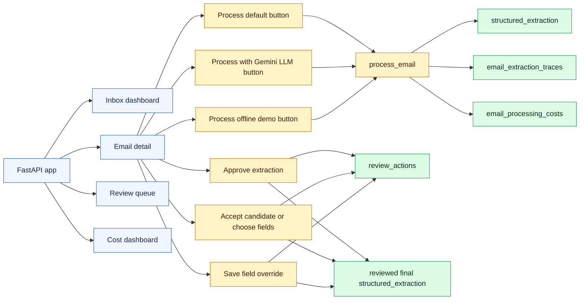

## Email Processing Function Flow

The central workflow is `process_email` in `src/inbox_da/agent.py`.

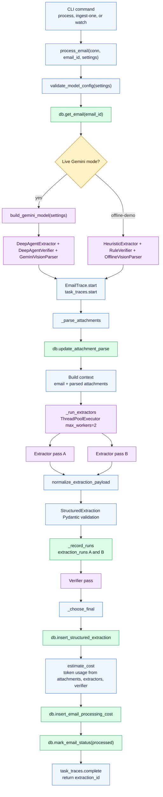

## Sequence Diagram

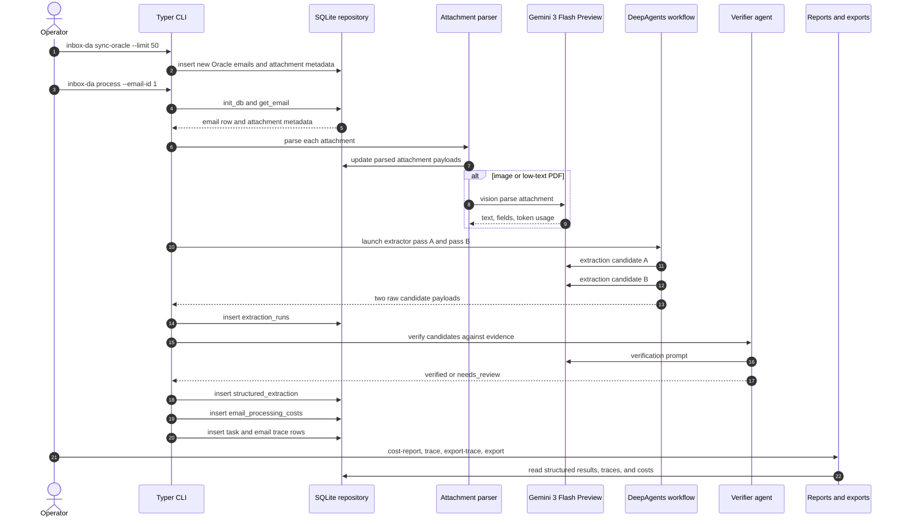

## Attachment Routing

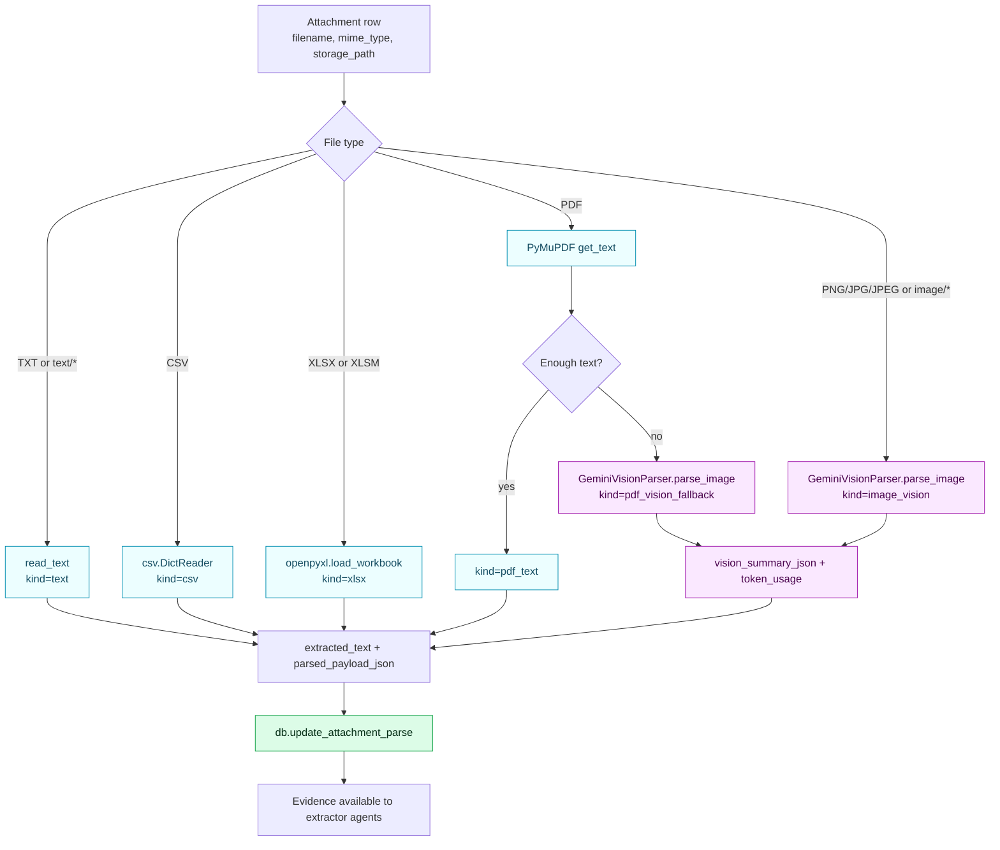

## DeepAgents, Skills, And Memory

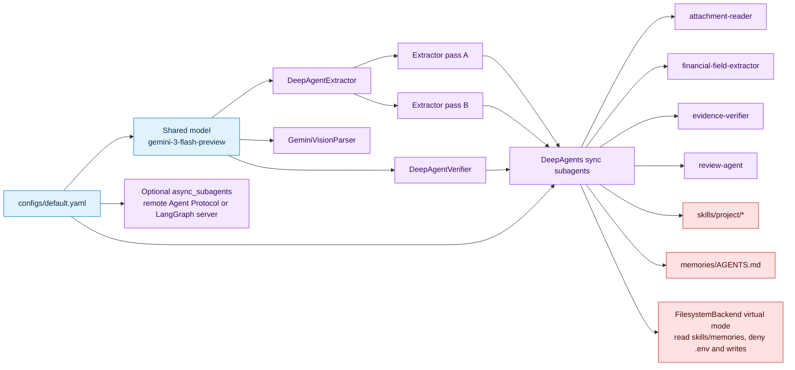

## Verification Policy

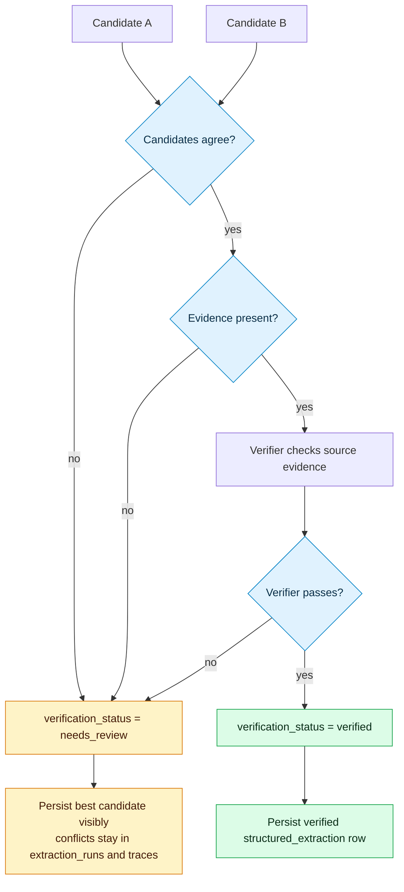

## SQLite Schema Diagram

SQLite is initialized from `src/inbox_da/schema.sql`.

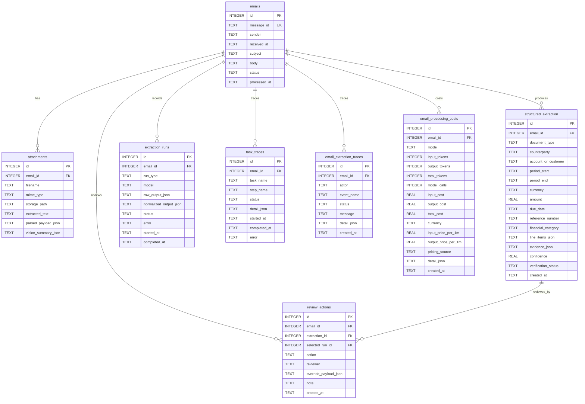

## Table Reference

### `emails`

Raw inbox messages copied from Oracle into the local processing store. This
table is intentionally local so extraction, review, trace, and cost history
remain auditable even when the upstream inbox is read-only.

| Column | Type | Notes |
|---|---:|---|
| `id` | INTEGER | Primary key |
| `message_id` | TEXT | Unique Oracle or external message id |
| `sender` | TEXT | Sender address |
| `received_at` | TEXT | Received timestamp |
| `subject` | TEXT | Email subject |
| `body` | TEXT | Raw email body |
| `status` | TEXT | `new`, `processing`, `processed`, or `failed` |
| `processed_at` | TEXT | Set when status becomes `processed` or `failed` |

### `attachments`

Attachment metadata and deterministic parse outputs. Files stay on disk under
`data/attachments/<email_id>/`; SQLite stores paths and parse metadata.

| Column | Type | Notes |
|---|---:|---|
| `id` | INTEGER | Primary key |
| `email_id` | INTEGER | Foreign key to `emails.id` |
| `filename` | TEXT | Attachment filename |
| `mime_type` | TEXT | MIME type used for parser routing |
| `storage_path` | TEXT | Local filesystem path |
| `extracted_text` | TEXT | Text made available to extractor agents |
| `parsed_payload_json` | TEXT | Parser-specific normalized JSON |
| `vision_summary_json` | TEXT | Gemini vision response and usage metadata when used |

### `structured_extraction`

Final normalized financial result for an email.

| Column | Type | Notes |
|---|---:|---|
| `id` | INTEGER | Primary key |
| `email_id` | INTEGER | Foreign key to `emails.id` |
| `document_type` | TEXT | Invoice, receipt, bank notice, statement summary, etc. |
| `counterparty` | TEXT | Vendor, customer, bank, or institution |
| `account_or_customer` | TEXT | Account, customer, or internal business reference |
| `period_start` | TEXT | Start date for statements or summaries |
| `period_end` | TEXT | End date for statements or summaries |
| `currency` | TEXT | Currency code extracted from source evidence |
| `amount` | REAL | Core amount extracted from source evidence |
| `due_date` | TEXT | Payment or action due date when present |
| `reference_number` | TEXT | Invoice, receipt, transfer, or notice reference |
| `financial_category` | TEXT | Accounts payable, receivable, treasury, cash, etc. |
| `line_items_json` | TEXT | JSON list of line items |
| `evidence_json` | TEXT | JSON list of field evidence with source pointers |
| `confidence` | REAL | Model or rule confidence |
| `verification_status` | TEXT | `verified` or `needs_review` |
| `created_at` | TEXT | Insert timestamp |

### `extraction_runs`

Raw and normalized outputs for each extractor pass.

| Column | Type | Notes |
|---|---:|---|
| `id` | INTEGER | Primary key |
| `email_id` | INTEGER | Foreign key to `emails.id` |
| `run_type` | TEXT | `extractor_a` or `extractor_b` |
| `model` | TEXT | Configured model name |
| `raw_output_json` | TEXT | Original agent payload |
| `normalized_output_json` | TEXT | Pydantic-ready normalized payload |
| `status` | TEXT | Run status |
| `error` | TEXT | Error details if a pass fails |
| `started_at` | TEXT | Insert timestamp |
| `completed_at` | TEXT | Completion timestamp |

### `task_traces`

Coarse task-level audit trail for processing stages.

| Column | Type | Notes |
|---|---:|---|
| `id` | INTEGER | Primary key |
| `email_id` | INTEGER | Optional foreign key to `emails.id` |
| `task_name` | TEXT | Example: `process_email` |
| `step_name` | TEXT | Example: `start`, `parse_attachment`, `complete` |
| `status` | TEXT | Stage status |
| `detail_json` | TEXT | Structured event metadata |
| `started_at` | TEXT | Insert timestamp |
| `completed_at` | TEXT | Completion timestamp when available |
| `error` | TEXT | Error text when available |

### `email_extraction_traces`

Detailed per-email timeline used by the terminal `trace` command and CSV trace
export.

| Column | Type | Notes |
|---|---:|---|
| `id` | INTEGER | Primary key |
| `email_id` | INTEGER | Foreign key to `emails.id` |
| `actor` | TEXT | Pipeline component, agent, parser, database, or cost stage |
| `event_name` | TEXT | Event name shown in trace output |
| `status` | TEXT | `ok`, `verified`, `needs_review`, or error-like status |
| `message` | TEXT | Human-readable terminal message |
| `detail_json` | TEXT | Structured event details |
| `created_at` | TEXT | Insert timestamp |

### `email_processing_costs`

Per-email token usage and estimated model cost.

| Column | Type | Notes |
|---|---:|---|
| `id` | INTEGER | Primary key |
| `email_id` | INTEGER | Foreign key to `emails.id` |
| `model` | TEXT | Configured model, required default `gemini-3-flash-preview` |
| `input_tokens` | INTEGER | Input tokens found in model metadata |
| `output_tokens` | INTEGER | Output tokens found in model metadata |
| `total_tokens` | INTEGER | Combined tokens |
| `model_calls` | INTEGER | Count of model responses with usage metadata |
| `input_cost` | REAL | Estimated input token cost |
| `output_cost` | REAL | Estimated output token cost |
| `total_cost` | REAL | Estimated total cost |
| `currency` | TEXT | Configured currency |
| `input_price_per_1m` | REAL | Configured input price per million tokens |
| `output_price_per_1m` | REAL | Configured output price per million tokens |
| `pricing_source` | TEXT | Pricing reference URL or note |
| `detail_json` | TEXT | Cost calculation details by stage |
| `created_at` | TEXT | Insert timestamp |

### `review_actions`

Append-only human review audit trail. The web console writes approvals,
candidate choices, field choices, and overrides here. When a reviewer applies a
choice, the app also appends a new final `structured_extraction` row with
`verification_status='verified'`; it does not overwrite the original model
output rows.

| Column | Type | Notes |
|---|---:|---|
| `id` | INTEGER | Primary key |
| `email_id` | INTEGER | Foreign key to `emails.id` |
| `extraction_id` | INTEGER | Optional foreign key to `structured_extraction.id` |
| `selected_run_id` | INTEGER | Optional foreign key to selected `extraction_runs.id` |
| `action` | TEXT | `approve`, `select_candidate`, `select_fields`, or `override` |
| `reviewer` | TEXT | Human reviewer label |
| `override_payload_json` | TEXT | Selected candidate, field choices, or manual override JSON |
| `note` | TEXT | Reviewer note |
| `created_at` | TEXT | Insert timestamp |

## Data Lifecycle

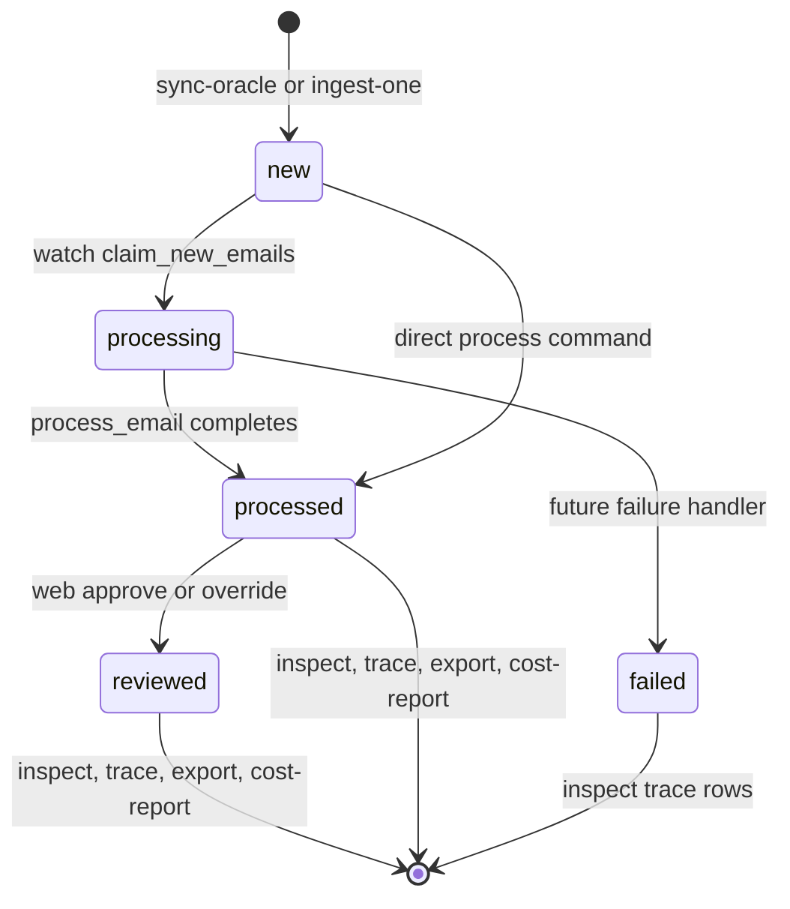

## Trace And Cost Reports

Every processed email writes a detailed trace to `email_extraction_traces`.
Trace events include the pipeline stage, actor, status, message, and JSON
details.

```bash
uv run inbox-da trace --email-id 1
uv run inbox-da export-trace --email-id 1 --output data/email_1_trace.csv
```

Each email also gets a row in `email_processing_costs`. The estimate uses token
usage metadata returned by Gemini/DeepAgents when available. The default Gemini
3 Flash Preview standard paid-tier pricing in `configs/default.yaml` is:

| Token side | Default price |
|---|---:|
| Input | `$0.50 / 1M tokens` |
| Output | `$3.00 / 1M tokens` |
| Source | https://ai.google.dev/pricing |

Costs are estimates because subagent/tool frameworks may not expose every
internal token in all response shapes.

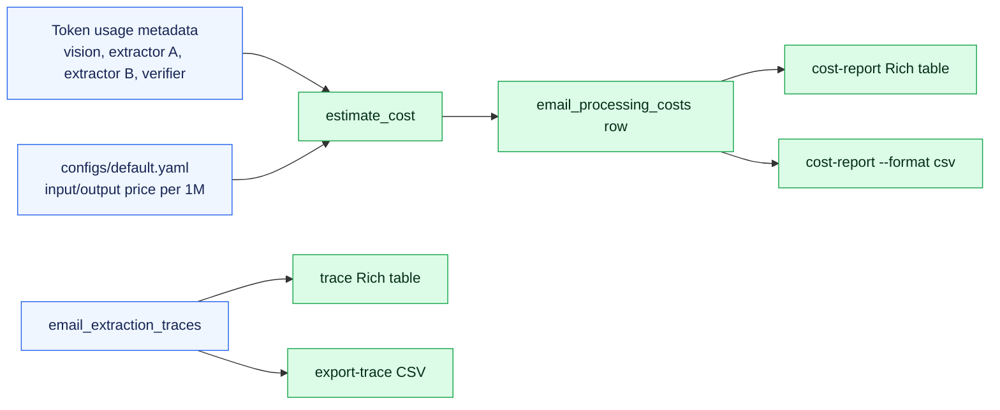

Use the report command to review the latest processing cost per email. Repeated
processing of the same message is summarized with the latest cost row so the
report does not double-count retries:

```bash
uv run inbox-da cost-report
uv run inbox-da cost-report --format csv --output data/cost_report.csv
```

## Primary Code Paths

| Area | File | Main functions or classes |
|---|---|---|
| CLI | `src/inbox_da/cli.py` | `init_db`, `sync_oracle`, `ingest_one`, `process`, `watch`, `inspect_email`, `trace_email`, `export_trace`, `cost_report`, `web` |
| Web monitor | `src/inbox_da/web.py` | `create_app`, inbox, email detail, review actions, cost dashboard |
| Workflow | `src/inbox_da/agent.py` | `process_email`, `_parse_attachments`, `_run_extractors`, `_choose_final` |
| Gemini and DeepAgents | `src/inbox_da/model_provider.py` | `build_gemini_model`, `build_deep_agent`, `build_subagents` |
| Attachment parsing | `src/inbox_da/attachments.py` | `parse_attachment`, `GeminiVisionParser`, `OfflineVisionParser` |
| Oracle inbox | `src/inbox_da/oracle_inbox.py` | `sync_oracle_inbox`, `OracleInboxClient`, `OracleEmailRecord`, `OracleAttachmentRecord` |
| Data access | `src/inbox_da/db.py` | typed insert, read, report, trace, cost, and status helpers |
| Schema | `src/inbox_da/schema.sql` | SQLite tables and foreign keys |
| Contracts | `src/inbox_da/models.py` | `StructuredExtraction`, `VerificationResult`, `Evidence`, `LineItem` |
| Costing | `src/inbox_da/costing.py` | `TokenUsage`, `CostEstimate`, `estimate_cost`, `collect_token_usage` |

## Quality Gates

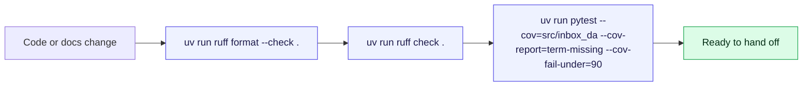

Run these before finishing changes:

```bash
uv run ruff format --check .
uv run ruff check .
uv run pytest --cov=src/inbox_da --cov-report=term-missing --cov-fail-under=90
```

The project is not considered complete unless Ruff is clean, all tests pass,
and line coverage is at least 90%.
